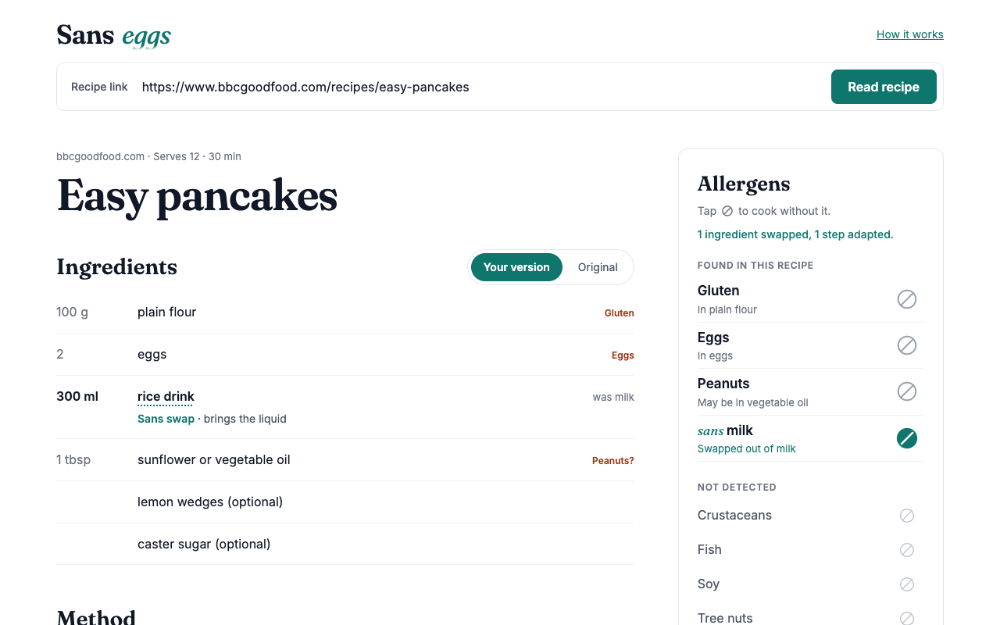

# Sans

Paste the URL of a recipe: Sans extracts it, shows which of the 14 EU regulatory allergens it contains, and can propose an adapted version that avoids the allergens you switched off.

Built for the [Symfony AI & MCP Hackathon](https://symfony.com/hackathon) (RAG, MCP, agents). Every allergen verdict comes from a deterministic lookup in PHP; the language model only extracts and normalises ingredients and proposes substitutions.



## Setup

You need a [Mistral API key](https://console.mistral.ai) and Docker with Compose. Start with the key, the install needs it to build the index:

```bash
git clone https://github.com/loicsapone/sans.git && cd sans
echo "MISTRAL_API_KEY=your-key" > .env.local
```

Then pick one of the two ways to run the app. Both build the index of the ingredient reference with Mistral embeddings, which takes about a minute.

### With the Symfony CLI

Needs PHP 8.5, Composer and the [Symfony CLI](https://symfony.com/download). PHP runs on your machine and only [Meilisearch](https://www.meilisearch.com), which holds the index, runs in Docker: the CLI finds its port by itself and serves the app on a free port.

```bash
composer install
docker compose up -d meilisearch
symfony console doctrine:schema:update --force
symfony console ai:store:setup ingredients --no-debug
symfony console ai:store:index ingredients --no-debug
symfony server:start -d
```

The last command prints the address of the app (http://127.0.0.1:8000 when the port is free).

### With Docker only

Nothing to install but Docker: the app runs in a FrankenPHP container.

```bash
make build up
make install
```

The app is served on https://localhost, with a local certificate your browser asks you to accept. When ports 80 and 443 are taken, choose others (`HTTP_PORT=8080 HTTPS_PORT=8443 make up`) and open https://localhost:8443.

### Try it

Paste the link of a recipe, in French or in English, for example:

- https://www.bbcgoodfood.com/recipes/easy-pancakes
- https://www.marmiton.org/recettes/recette_pate-a-crepes_12372.aspx
- https://www.marmiton.org/recettes/recette_gratin-dauphinois-tres-facile_58956.aspx

Then tap the mark of an allergen to cook without it. `/?url=<recipe link>` shares an analysis: an address that was already analysed is shown at once (analyses are kept for a week).

## What Symfony AI unlocked

Sans is five agents, one vector store and one MCP connection, and almost all of it is configuration (`config/packages/ai.yaml`). What made the difference:

- **Typed answers.** Every agent answers with a PHP class given as `response_format` (`IngredientLines`, `MatchChoices`, `AdaptationAnswer`...). A backed enum in that class (`Role`) becomes an `enum` of the JSON schema and comes back as the enum case. There is no JSON to parse or to validate by hand anywhere in the project.
- **A model that can only pick what the search returned.** The matcher's tool implements `HasSourcesInterface`: the documents it found travel with the answer, and PHP only accepts an id that is among them. The allergens are read from those documents, never from the model.
- **Hybrid search without writing a query.** The Store component gives a `HybridQuery` (words and meaning) over Meilisearch, and the index is built by its own commands from a CSV file, with a loader, a transformer and a vectorizer declared in YAML.
- **An agent as the tool of another.** The adapter checks its own proposals with a tool that runs the matcher, so a swap is verified against the reference before the answer is even written.
- **MCP in both directions.** Sans is a server too: three tools, one class, a few lines of YAML (see below).
- **A remote MCP server as a tool belt, and as a plain client.** One line (`mcp_server: food.openfoodfacts`) gives an agent the tools of the Open Food Facts server; the same connection is injected in PHP to call a tool directly, which is how the product counts stay out of the model's hands.

The pattern that runs through all of them: the model proposes, PHP decides. Symfony AI made that cheap enough to apply everywhere.

## Reference data

`resources/data/ingredients.csv` is the ingredient reference: a French and English vocabulary (name and plural in each language, parent) and, for each of the 14 EU allergens, whether it is present in every ordinary version (`always`) or only in some products (`depends`).

The index is built from this file (`make index` with Docker) with the commands of the Symfony AI Store component (`ai:store:setup`, `ai:store:clear`, then `ai:store:index ingredients`): its `CsvLoader` reads the rows, and a transformer turns each of them into one document per ingredient, embedded from its names, with its names and allergens stored in the document metadata, so that a search result is all the verdict needs.

The French vocabulary comes from [Marmiton](https://www.marmiton.org); the English names and the allergen columns were drafted with a language model and still need a human review. The rows from id 90001 are the free-from substitutes that swaps rely on (rice flour, soy milk, coconut oil...): they were written by hand, with their allergens, from the swaps the agent proposes most.

## Matching

The names found in a recipe are matched to the reference by a Symfony AI agent (`ai.agent.matcher`). It calls the `search_ingredients` tool once with all the names, which embeds them in a single request and runs one hybrid search per name (a `HybridQuery`: half on the words of the name, half on its meaning) to return the five best ingredients of each, then picks one result for each name or none. The words find "olive oil" or "stock cube" where the embedding alone drifts to a neighbour, the meaning finds "muscade" behind "noix de muscade". Only ingredients the tool actually returned are accepted, and their allergens come from the index, never from the model (about 3 seconds for a recipe).

## Analysing a recipe

```bash
bin/console app:analyze https://example.com/a-recipe
```

The command fetches the page (public web pages only, with a size and time limit), reads the recipe from its schema.org data or, failing that, with the model (which is only sent the readable part of the page, found by [php-readability](https://github.com/j0k3r/php-readability)), normalises the ingredient lines, matches them to the reference and prints the allergens it found with the ingredients responsible. It reports the stage that failed (`fetch`, `extract`, `normalise`, `match`) and the time each stage took.

## Cooking without an allergen

Tapping the mark of an allergen asks an agent (`ai.agent.adapter`) for a swap for each ingredient line that carries it, plus the steps rewritten to match. Each swap comes with the role the ingredient plays in the recipe (binder, fat, leavening...), an enum of the structured output. The agent has a `check_ingredients` tool to look up its own proposals before answering; that tool runs the matcher, so one agent calls another. Whatever the agent did with it, the model proposes and the server checks: the plain ingredients of each swap are looked up with the matcher, and a swap is kept only if all of them are in the reference and none carries (or may carry) an avoided allergen. Refused swaps are asked again with the reason, three attempts at most; a line without a safe swap says so. Ingredients that only *may* carry the allergen (a stock cube, a chocolate) are offered to the agent too, once: when it has no ingredient that is surely free of it, the page asks to read the label. Adaptations are stored by address and set of allergens. A swap takes 10 to 15 seconds, and how many lines succeed depends on how well the reference covers common substitutes.

## Reading the labels

For an ingredient that only *may* carry an avoided allergen, Sans is a client of the [Open Food Facts MCP server](https://github.com/cyanheads/openfoodfacts-mcp-server) to say what the labels of real products say: "On Open Food Facts, 469 of 992 products in “Stock cubes” declare celery."

An agent (`ai.agent.labels`) gets the tools of the remote server (`mcp_server: food.openfoodfacts` in `config/packages/ai.yaml`, the connection is in `config/packages/mcp.yaml`) and finds the category of the ingredient in the Open Food Facts taxonomy. The counts are then asked to the server from PHP, through the same MCP connection: the model picks a category, it never writes a number. The sentence is a Live component of its own (`ProductLabel`) that the recipe page loads after itself (`loading="defer"`): the lookup starts when the allergen is tapped and runs next to the swaps, without holding them back. What was found is cached for a week.

It is a help to choose a product, not a verdict: Open Food Facts is filled in by volunteers, many products have no allergen entered, and the category the agent picks can change from one run to the next. The server is a public one (`OPENFOODFACTS_MCP_URL`) with a small budget of searches; when it does not answer, the page only asks to read the label. Finding the categories takes about 10 seconds, sometimes 20; the adapted recipe does not wait for it.

## Sans as an MCP server

Sans is also an MCP server, so that an assistant can ask it the same questions as the page. It is declared in `config/packages/mcp.yaml` (`servers.sans`) and its three tools are the methods of one class, `App\Mcp\RecipeTools`, which calls the services the page uses:

| Tool | What it does |
|---|---|
| `analyze_recipe` | Reads the recipe of a web page: its ingredient lines with the allergens each one carries, and a verdict for each of the 14 allergens |
| `adapt_recipe` | Gives the swaps and the rewritten steps to cook that recipe without the given allergens |
| `check_ingredients` | Looks up ingredient names in the reference and returns their allergens |

Analyses and adaptations are shared with the page: a recipe analysed on one side is shown at once on the other.

Over HTTP, the endpoint is `/mcp` on the address of the app (http://127.0.0.1:8000/mcp with the Symfony CLI). Over STDIO, the server is a command:

```json
{
    "mcpServers": {
        "sans": {
            "command": "sh",
            "args": ["-c", "cd /path/to/sans && exec symfony console mcp:server"]
        }
    }
}
```

With Docker only, replace the command with `docker compose exec -T php bin/console mcp:server`. `bin/console debug:mcp` lists the tools.

The endpoint has no authentication and each call costs model requests: it only answers requests made to `localhost` (the DNS rebinding protection of the SDK, `http.allowed_hosts`), and it must stay that way unless it is put behind an authentication.

## Symfony AI: what got in the way

[docs/symfony-ai-limits.md](docs/symfony-ai-limits.md) lists the limits met with the Store, Agent and Platform components, with what Sans does about each and what a fix could look like.

## Quality

```bash
make static   # PHP-CS-Fixer, Twig-CS-Fixer, PHPStan
make test     # PHPUnit
make ci       # both
```
